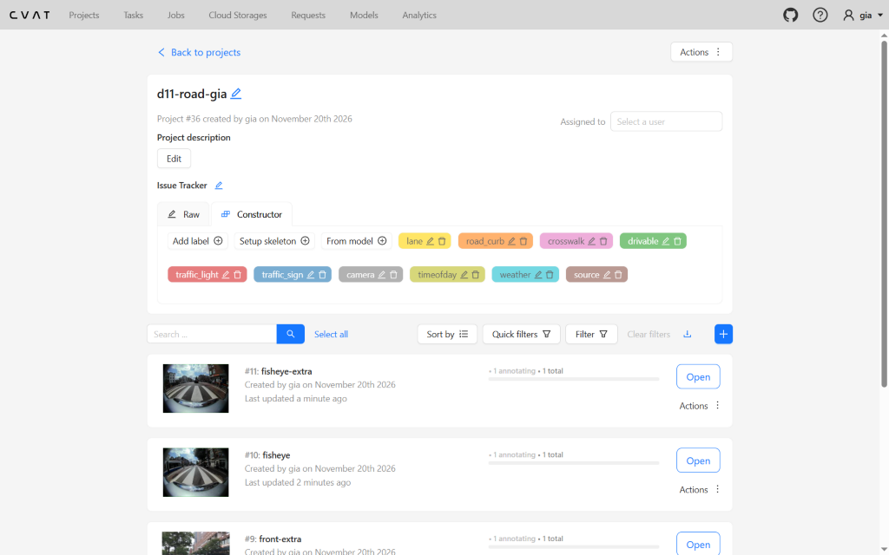
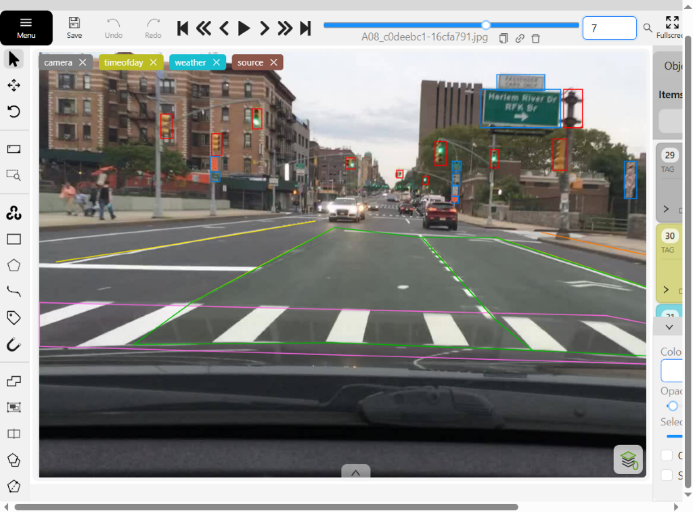
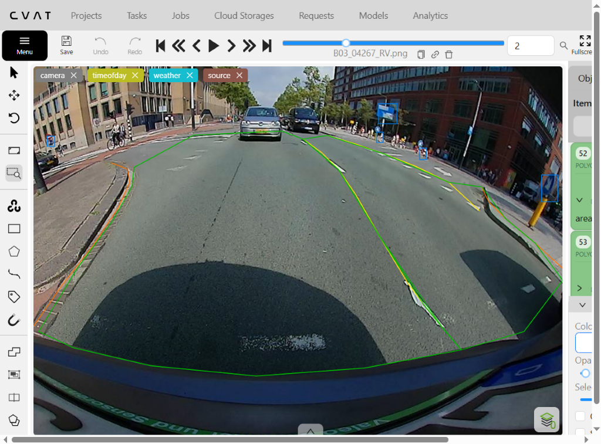
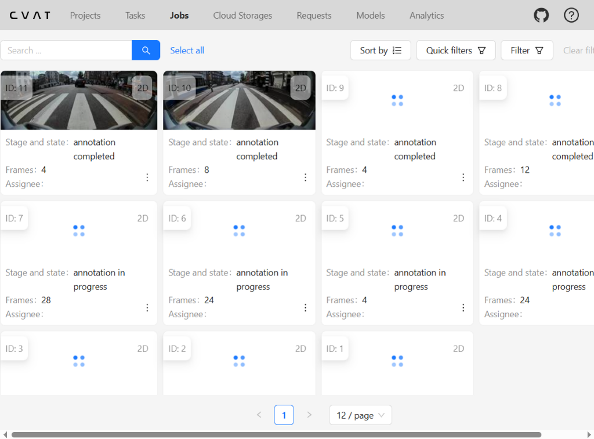

# Báo cáo cá nhân — Ngày 11
Họ tên: Đặng Hoàng Gia               Mã học viên: 2A202603065  
Phiên bản CVAT (Help → About): 2.74.1 (Server 2.74.1, UI 2.74.1)  
Guideline: Road v1.0    Lần nộp (`revision` trong manifest): 1  
Thời điểm export (ngày giờ trên CVAT): 2026-11-20 23:34 (+07:00)    Số lần nộp lại sau Rework: 0  

## 1. Kiểm project
| Mục | Đúng như guideline Road v1.0? | Ghi chú |
| --- | --- | --- |
| 6 label, đúng kiểu | Có | `lane` (polyline), `road_curb` (polyline), `crosswalk` (polygon), `drivable` (polygon), `traffic_light` (rectangle), `traffic_sign` (rectangle) — đã đối chiếu với `configs/road_v1_labels.json` trong project `d11-road-gia` (#36). |
| Thuộc tính và giá trị | Có | Khớp 100% danh sách thuộc tính, kiểu select/checkbox và giá trị mặc định của Road v1.0. |
| 4 tag ảnh | Có | 4 label kiểu Tag (`camera`, `timeofday`, `weather`, `source`), mỗi tag có thuộc tính select `value` đúng chuẩn. |
Cách kết thúc polyline trên bản CVAT này: Nhấn phím `N` (hoặc double-click vào điểm cuối) sau khi đặt các điểm theo thứ tự từ gần xe ra xa.  
Cách đặt tag ảnh trên bản CVAT này: Chọn công cụ **Tag** ở thanh bên trái, chọn từng label (`camera`, `timeofday`, `weather`, `source`) và bấm **Add tag**, sau đó mở **Details** ở bảng Objects bên phải để chỉnh đúng giá trị `value` cho từng ảnh.  

## 2. Số lượng đã gán
| Task | Ảnh | lane | road_curb | crosswalk | drivable | traffic_light | traffic_sign |
| --- | ---: | ---: | ---: | ---: | ---: | ---: | ---: |
| front | 12 | 29 | 12 | 4 | 24 | 37 | 51 |
| front-extra (đã làm 4 / 4) | 4 | 10 | 2 | 2 | 8 | 13 | 17 |
| fisheye | 8 | 7 | 13 | 7 | 10 | 9 | 7 |
| fisheye-extra (đã làm 4 / 4) | 4 | 0 | 5 | 4 | 4 | 1 | 2 |

## 3. Bảng ca khó
| Ảnh | Nhãn | Phân vân giữa | Đã chọn | Lý do |
| --- | --- | --- | --- | --- |
| A03 | `lane` (`L1`, `R1`) | `L1` là `single` hay `double` ở vùng dải sơn vàng gạch chéo; `R1` dừng trước chữ `SCHOOL`/xe che hay nối qua | `L1`: `solid/yellow/single`; `R1`: nối liền 1 polyline và bật `occluded` | Vạch sát làn mình ở `L1` là mép đơn của vùng sơn đảo an toàn (`y=550..374`); `R1` bị che ngắn bởi chữ sơn `SCHOOL` và xe SUV nên nối qua kèm `occluded` theo quy tắc làn. |
| A05 | `lane` (`L1`/`R1`), `drivable` | Có vẽ `L1`/`R1` giả định không; vùng trống sát lề phải có đưa vào `direct` không | Không vẽ `L1`/`R1` (gán `road_curb` hai bên); `drivable` chỉ lấy phần lòng đường chạy xe, loại dải đỗ xe sát lề | Đường phố hẹp hoàn toàn không có vạch sơn làn (theo mục 6 hướng dẫn: không vẽ vạch không tồn tại, gọi coach xác nhận miễn `QC1-02`); dải đỗ xe sát lề không tính vào `direct` kể cả chỗ trống. |
| A06 | `lane` (`R1`), `traffic_light` | Bên phải làn đang đi là hàng cột cầu cạn (không có vạch sơn); đèn người đi bộ sáng hình người trắng chọn `color` nào | Không vẽ `R1` (chỉ vẽ `L1` vàng đôi và `R2` ở làn ngoài cột); đèn người đi bộ chọn `type=pedestrian, color=unknown` | Không tự bịa vạch `R1` khi mặt đường không có vạch sơn; Road v1.0 chỉ có `red/yellow/green/off/unknown` nên tín hiệu trắng đi bộ xếp `unknown`. |
| A07 | `lane` (`L1`), `weather` | Bên trái sát dải phân cách bê tông (jersey barrier) không có vạch sơn; trời âm u nhưng mặt đường ướt bóng + hạt nước kính | Không vẽ `L1` (dùng `road_curb` dọc chân dải bê tông); chọn `weather=rain` | Mặt đường không sơn vạch trái nên miễn `QC1-02` sau khi xác nhận; theo guideline, mặt đường ướt rõ do mưa và có nước trên kính xếp `rain`. |
| A10 | `lane` (`R1`), `traffic_sign` | Giọt nước lớn trên kính che đoạn giữa vạch `R1`; cụm 3 biển đỗ xe chồng nhau góc trái trên gộp hay tách hộp | Nối liền `R1` qua vùng bị che và bật `occluded`; tách 3 hộp riêng cho 3 tấm biển | Tuân thủ quy tắc nối liền đoạn che ngắn kèm `occluded`, và mỗi tấm biển/biển phụ có hộp sát mép riêng biệt. |
| A12, A14 | `lane` (`R1`) | Bên phải làn đi không có vạch sơn kẻ làn (xe đỗ sát vỉa hè ở `A12`, ngã tư ban đêm ở `A14`) | Không vẽ `R1`, chỉ gán các vạch thực sự tồn tại (`L1`/`L2`) | Thực tế trên ảnh không thấy vạch sơn bên phải; tuân thủ mục 6 không bịa vạch và ghi chú miễn `QC1-02`. |
| A15 | `drivable` | Công trường có hàng cọc tiêu cam sát lề phải | Cắt `drivable` (`alternative`) dừng ngay vạch `R2`, không tràn ra sau hàng cọc cam | Tuân thủ quy tắc vùng lái: tuyệt đối không gồm lề đường và vùng phía sau cọc tiêu. |
| B02, B03, B04, B10 | `traffic_light`, `traffic_sign` (`edge_zone`) | Xác định đèn/biển nào nằm ngoài 80 % bán kính vòng ảnh fisheye | Tính tâm hộp so với `0,8 × (W/2) = 512 px` từ tâm `(640, 483)`: bật `edge_zone` cho các cụm đèn sát mép ở `B02`, biển tròn xanh góc phải ở `B03`, biển cấm ngược chiều ở `B04`, biển `P` sát mép ở `B10` | Đảm bảo nhất quán chính xác với định nghĩa 80 % bán kính trong guideline và `road_check lint`. |
| B05–B08 | `lane`, `crosswalk`, `drivable` | Camera hai bên (`MVL`/`MVR`) đặt `position` gì cho `lane`, và cắt `drivable` quanh thân xe thế nào | Mọi `lane` ở camera hai bên đặt `position=other`; vạch ngựa vằn gán `crosswalk` (polygon); cắt `drivable` bám sát mép cong thân xe | Tuân thủ chặt quy tắc fisheye (mục 4 guideline): camera hai bên luôn dùng `position=other`, tuyệt đối không gán lên thân xe mình. |
| B11 | `lane` (bẫy ô đỗ `QC1-03`) | Các vạch trắng/vàng gạch chéo quanh ô đỗ xe người khuyết tật có gán `lane` không | **Không gán `lane`** (0 vạch làn), chỉ gán `road_curb`, `drivable` dừng ở mép cản sau và biển thông tin | Tuân thủ quy tắc mục 4: "Vạch ô đỗ không gán `lane`" để tránh lỗi nặng `QC1-03`. |

## 4. Phiếu QC 1 nhận được
Bạn kiểm lô của tôi: Trịnh Xuân Toàn - 2A202603121 (`xuantoan`) *(mẫu 6 ảnh `A05, A06, A07, B03, B06, B08` — 80 nhãn; phiếu gốc tại [xuantoan-qc1-for-gia.md](xuantoan-qc1-for-gia.md))*  
Quyết định nhận được: **Hold (tạm thời)** *(0 lỗi nặng / 0 lỗi nhẹ đã xác nhận; chờ xác nhận bằng mắt / lead miễn `QC1-02` cho 3 ảnh `A05`, `A06`, `A07`)*  

| Mã lỗi | Số lỗi | Đồng ý? | Đã sửa? |
| --- | ---: | --- | --- |
| QC1-01 (tag camera & 4 tag) | 0 | Đồng ý (đạt 6/6 ảnh mẫu) | Không cần sửa |
| QC1-02 (thiếu `L1`/`R1` trên `A05`, `A06`, `A07` — 4 cảnh báo `lint`) | 4 ứng viên (chưa xác nhận) | **Không đồng ý xếp lỗi (đề nghị miễn theo mục 6 hướng dẫn & CHECKPOINTS):** `A05` là phố hẹp hoàn toàn không sơn vạch làn (đã gán `road_curb` hai bên); `A06` bên phải là hàng cột cầu cạn thép không có vạch `R1`; `A07` bên trái sát dải phân cách bê tông không có vạch `L1` (đã gán `road_curb`). | **Không vẽ thêm** (không bịa vạch không tồn tại trên ảnh); đã ghi rõ mã ảnh & lý do ở Mục 3 Bảng ca khó và đề nghị coach/lead xác nhận miễn `QC1-02` để chốt **Release** (giữ nguyên `revision: 1`). |
| QC1-03 (`position` trên `B03, B06, B08`) | 0 | Đồng ý (`B06`, `B08` dùng đúng `position = other`) | Không cần sửa |
| QC1-12 (file, manifest, `sha256`, `contains_images`) | 0 | Đồng ý (2 file ZIP mở được, không kèm ảnh, khớp manifest) | Không cần sửa |

*(Ghi chú bổ sung: phiếu của bạn `xuantoan` là lượt kiểm sơ bộ theo script/lint nên các mã hình học `QC1-04` đến `QC1-11` chưa kiểm bằng mắt; toàn bộ 28 ảnh trong lô của mình đã được tự kiểm trực quan từng ảnh đạt ≤ 2–3 px và 0 lỗi chính/nhẹ trên `road_check lint`, không phát sinh Rework nên giữ nguyên lần nộp `revision: 1`.)*

## 5. Kiểm file export
| File | Mở lại được? | Số shape ảnh 1 (job / file) | Số shape ảnh 2 (job / file) | Tag camera có trong XML? |
| --- | --- | --- | --- | --- |
| `gia-front.zip` | Có (`road_check lint` mở được, `contains_images: false`) | A01: 9 / 9 | A02: 6 / 6 | Có (16/16 ảnh đủ 4 tag) |
| `gia-fisheye.zip` | Có (`road_check lint` mở được, `contains_images: false`) | B01: 5 / 5 | B02: 10 / 10 | Có (12/12 ảnh đủ 4 tag) |

## 6. Ảnh chụp màn hình
1. **Tab Labels của project (`d11-road-gia`, `#36`):**

   

2. **Một ảnh camera trước đã gán đủ (làn, vùng lái, đèn/biển — `A08`, Job `#8`):**

   

3. **Một ảnh fisheye đã gán, phóng to đoạn polyline cong (`B03`, Job `#10`):**

   

4. **Trạng thái 4 job (`#8`, `#9`, `#10`, `#11`) đã chuyển `completed`:**

   

5. **Một đoạn XML có `<polyline label="lane">` (trích từ `gia-front.zip/annotations.xml`):**
```xml
<polyline label="lane" source="manual" occluded="0" z_order="0" points="0.00,599.00;120.00,563.00;240.00,528.00;336.00,501.00">
  <attribute name="position">L2</attribute>
  <attribute name="style">solid</attribute>
  <attribute name="color">white</attribute>
  <attribute name="kind">double</attribute>
</polyline>
```

## 7. Tự đánh giá
Lỗi bạn mắc nhiều nhất hôm nay (theo mã QC1-xx), và cách tránh ở Ngày 20:  
- Ban đầu dễ mắc lỗi **`QC1-01`** (quên gắn đủ 4 tag ảnh hoặc để nguyên giá trị mặc định của CVAT) và **`QC1-03`/`QC1-04`/`QC1-07`** (nhầm làn `L1` với `L2` trên đường nhiều làn ở `A01`, đặt `drivable` tràn vào dải đỗ xe sát lề ở `A05`, hoặc lệch tâm vạch > 5 px trên ảnh cao tốc `A15`). Cách tránh cho Ngày 20: luôn làm đúng thứ tự **4 tag trước tiên → kiểm Details ngay sau khi vẽ từng vạch → tự kiểm bằng `road_check lint` và rà trực quan từng ảnh trước khi Finish job**.

Nhãn của bạn đi vào model ở đâu? Chọn một lỗi đã sửa và nói nó làm model học sai thế nào:  
- Các polyline `lane` được chuyển thành đích tọa độ hàng neo (**row-anchor**) hoặc đường cong làn cho bài toán phát hiện làn / giữ làn (**LKA**), còn `drivable` và `traffic_light`/`traffic_sign` làm nhãn huấn luyện mô hình phân đoạn vùng lái được và nhận diện đèn/biển.
- Ví dụ lỗi **`QC1-03` (gán nhầm `L2` thành `L1` ở `A01`)**: nếu vạch ngoài cùng bên trái bị gán thành `L1`, mô hình LKA sẽ ước lượng sai tâm làn hiện tại lệch hẳn sang làn bên trái gần một thân xe, dẫn tới điều khiển đánh lái lệch làn gây mất an toàn. Tương tự, nếu để `drivable` `direct` tràn vào dải đỗ xe sát lề (`A05`), mô hình phân đoạn vùng lái được sẽ coi khu vực có nguy cơ xuất hiện xe đỗ/mở cửa là làn đi thẳng an toàn.

## 8. (Tùy chọn, buffer) Từ polyline đến đích row-anchor
*(So sánh trực tiếp vạch trắng đứt `L1` trên ảnh `A01` bằng `road_lab.rowanchor` giữa `gia-front.zip` `lane#1@(110,720)` và `xuantoan-front.zip` `lane#0@(110,717)` — lưu ý bạn `xuantoan` gán nhầm vạch này thành `R1`)*

| y | 720 | 680 | 640 | 600 | 560 |
| --- | ---: | ---: | ---: | ---: | ---: |
| x của chúng tôi (`gia`, `A01` — `L1`) | 110.0 | 157.5 | 204.8 | 251.9 | 298.9 |
| x của bạn kia (`xuantoan`, `A01` — `lane#0`) | không có làn | 153.9 | 202.5 | 251.6 | 298.3 |

Trả lời 3 câu:

1. Năm số x đó chính là đích mà một model row-anchor học cho vạch này. Nếu bạn dừng polyline sớm 40 px, hàng nào đổi thành "không có làn"?
   - Nếu dừng đầu gần sớm 40 px (tức `y` bắt đầu ở `680` thay vì `720`), hàng sát xe **`y = 720`** đổi ngay thành **"không có làn"** (thực tế bạn `xuantoan` chỉ dừng sớm 3 px tại `y = 717` là hàng `y = 720` đã mất thành `"không có làn"`). Nếu dừng đầu xa sớm 40 px, hàng xa nhất vượt quá điểm dừng mới (ví dụ `y = 560` nếu polyline kết thúc ở `y > 560`) sẽ đổi thành **"không có làn"**.
2. So với bạn được kiểm (cùng ảnh): ở hàng 720 và hàng 560, hai bạn lệch nhau bao nhiêu pixel? Lệch ở hàng nào ảnh hưởng LKA nhiều hơn (slide 25)?
   - Ở hàng **`y = 720`**: bài của mình là `110.0`, bài bạn `xuantoan` bị **"không có làn"** do điểm đầu dừng tại `y = 717` (tại hàng gần nhất cùng có giá trị `y = 680`, hai bên lệch `|157.5 - 153.9| = 3,6 px`).
   - Ở hàng **`y = 560`**: hai bên lệch `|298.9 - 298.3| = 0,6 px`.
   - Lệch hoặc mất điểm ở hàng gần xe (**`y = 720`**) ảnh hưởng trực tiếp tới **LKA** nhiều hơn vì sai số tọa độ ngay trước mũi xe làm lệch vị trí ngang tức thời (lateral offset) và góc lái hiệu chỉnh của hệ thống giữ làn.
3. Nếu polyline vẽ từ xa về gần (ngược quy tắc 2), cách tính trên có đổi không? Script nào sẽ gặp khó?
   - Về mặt hình học giao điểm đoạn thẳng với đường ngang `y = const`, tập điểm giao không đổi nếu script duyệt từng đoạn không phân biệt chiều; **nhưng** các script giả định thứ tự điểm từ gần ra xa (`y` giảm dần) để nội suy đơn điệu (binary search / duyệt theo thứ tự) hoặc kiểm tra điểm đầu sát xe (`d_near`), chiều vẽ (`QC1-04` trong `road_check.py`) sẽ **báo lỗi ngược chiều** hoặc lấy nhầm đầu gần/đầu xa.
